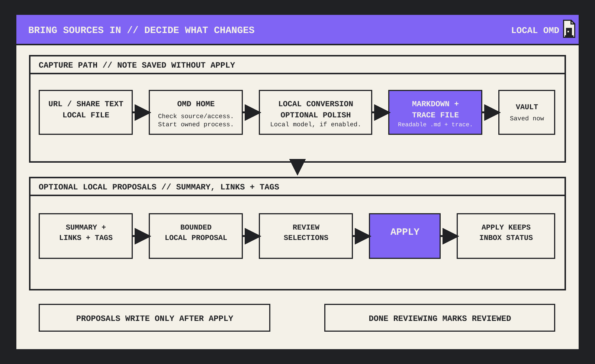
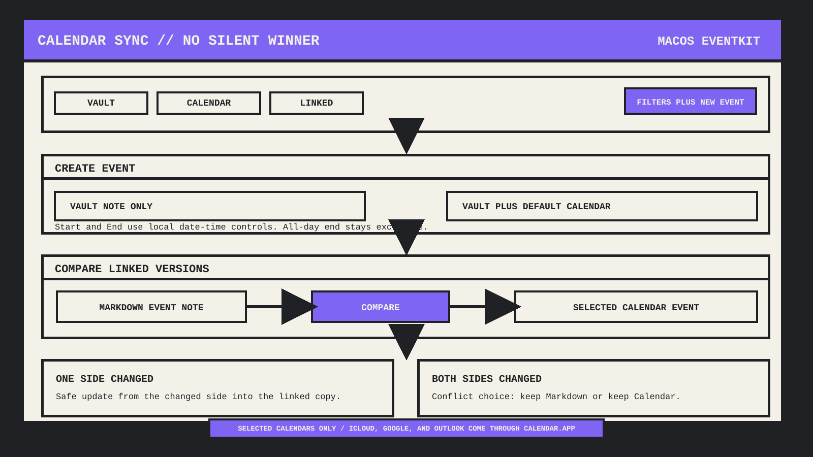

<div align="center">


<sub>OMD HOME // PUBLIC BETA 0.2.2</sub>

# OMD Home

**A single doorway for capture, calendars, review, and vault-grounded questions.**

The note is your vault. The doorway is the controlled working surface around it.

Bring sources in. See the day. Ask with evidence. Review AI-suggested changes before they land.
Your Markdown files remain the source of truth.

[](https://github.com/omd-local/obsidian-omd-home/actions/workflows/ci.yml)
[](https://github.com/omd-local/obsidian-omd-home/releases/latest)
[](https://obsidian.md/)
[](LICENSE)

[](docs/getting-started-mac.md)
[](docs/getting-started-mac.en.md)

[New here?](docs/getting-started-mac.en.md) ·
[Install](#install) ·
[Sources](#source-menu) ·
[See the rooms](#one-doorway-four-rooms) ·
[Configure](#choose-your-setup) ·
[About](#about) ·
[LinkedIn](https://www.linkedin.com/in/jacquelin-r-915655123/) ·
[Test](https://github.com/omd-local/obsidian-omd-home/blob/0.2.2/docs/manual-test-plan.md) ·
[Report an issue](https://github.com/omd-local/obsidian-omd-home/issues)

</div>

> [!IMPORTANT]
> OMD Home requires Obsidian desktop 1.11.4 or newer. It is a desktop-only plugin.
> Home, Markdown events, capture, and local AI work on supported desktop
> platforms. Apple Calendar integration requires macOS 14 or newer and the
> separately built EventKit helper. Until OMD Home is listed in Obsidian
> Community Plugins, install it from GitHub Releases.
>
> OMD Home does not install, update, or bundle OMD, Python, Ollama, or the EventKit helper.
> When OMD is missing, the plugin can copy the official install commands or
> open the official guide. It never executes those commands for you.

## Start here / 新用户从这里开始

**Mac installation guides: [简体中文](docs/getting-started-mac.md) · [Full English guide](docs/getting-started-mac.en.md).**
Both cover the complete plugin and backend installation, first capture,
optional transcription, local AI, selected-calendar setup, upgrades, and recovery.
The plugin downloads require no source build; the optional Calendar helper
currently has a separate source-build path.

| Component | Public release | What to expect |
|---|---|---|
| **OMD Home plugin** | [0.2.2 public beta](https://github.com/omd-local/obsidian-omd-home/releases/tag/0.2.2) | Three plugin assets; Obsidian desktop 1.11.4+ |
| **OMD conversion backend** | [0.3.0b5 via Homebrew](https://github.com/omd-local/markdown-everything/releases/tag/v0.3.0b5) | Separate install; matching capture-language, social-access, and local Ollama interfaces |
| **Optional tools** | Installed separately | Apple Silicon Whisper for speech, Ollama and models for AI, EventKit helper for Apple Calendar |

The public `main` branches now include this release's source. Use the pinned
release assets or tags below for a reproducible installation. Capability checks
and external prerequisites still determine which optional workflows are ready.
The backend browser UI remains deferred; OMD Home is the desktop interface.
DeepSeek API remains unavailable under this backend release's verified policy.

## One doorway, four rooms

OMD Home is a doorway, not a second vault. Capture, calendar, review, and
vault Q&A share one controlled entrance while Obsidian remains the source of truth.


### Four rooms, one source of truth

| Surface | What it is for |
|---|---|
| **Home** | A centered dashboard for Today, Upcoming, Recent notes, Pinned notes, Vault tags, system health, and the work that needs attention. |
| **Omnibox** | Vault search, Obsidian and community commands, quick notes, URL or file capture, event creation, recording commands, and read-only `@` vault questions. |
| **Calendar** | Month, week, day, and list views for Markdown events plus explicitly selected macOS calendars. |
| **Inbox** | Recent OMD captures, review-first link and tag suggestions, current work, failures, timestamps, details, retry, and cancellation. |

Widgets use a 12-column grid, move occupied cards out of the way, and keep their
layout per device viewport. Standard sizes are always available from each
widget menu, so a desktop layout does not have to fit a different screen.

## Source menu

Bring a supported URL or local file into your vault through the
[OMD conversion backend](https://github.com/omd-local/markdown-everything).
Home accepts **one URL or file at a time**; folder and list batches use the
backend command line. Available routes depend on installed tools and source access.


<details>
<summary><strong>Text version // formats, sources, and requirements</strong></summary>

| Source | Formats or examples | Requirements and limits |
|---|---|---|
| **Documents** | PDF, DOCX, PPTX, XLSX, HTML, CSV, JSON, XML, EPUB, ZIP | MarkItDown and the relevant converters. |
| **Images** | PNG, JPG, WEBP, TIFF, BMP | Tesseract OCR and the selected language packs. |
| **Audio** | MP3, WAV, M4A, FLAC, OGG | Local Whisper, its model, and ffmpeg must be installed; see the Mac guide for the Apple Silicon setup. |
| **Web** | Articles, WeChat, public webpages | A source adapter or web conversion; source access rules apply. |
| **Public posts** | Reddit, X, Bluesky, Mastodon, Threads, Hacker News, Telegram | Bounded public adapters; browser login does not guarantee converter access. |
| **Media URLs** | Apple Podcasts, YouTube, TikTok, Bilibili | Metadata and local transcription; install the selected route's tools and model, including yt-dlp for video URLs. Missing tools or source access can stop Capture. |
| **Local batches** | Folders and saved one-item-per-line lists | Backend CLI only; each item is routed independently. Not connected to Home Capture. |
| **Douyin / Xiaohongshu (Rednote)** | A URL or supported single-link share message | Normally require separate Netscape-format `cookies.txt` exports from `douyin.com` and `xiaohongshu.com`, respectively. Use only authorised accounts and content; do not reuse cookie files across platforms or commit them. |

</details>

OMD does not bypass paywalls, login gates, captchas, access controls, or platform
restrictions. Public posts may be deleted, private, quarantined, region-blocked,
or rate-limited. See the **Douyin and Xiaohongshu / Rednote access** setup below
for local cookie paths and readiness checks.

## Bring sources in. Decide what changes.

Paste one public URL, paste one local file path, drop one file onto Home, or
paste a common Douyin or Xiaohongshu / Rednote share message that contains
exactly one HTTP(S) URL.
OMD Home starts a managed OMD process, reports progress, and leaves conversion
ownership with [Markdown Everything](https://github.com/omd-local/markdown-everything).

Share-message extraction is deliberately limited to Douyin and Xiaohongshu /
Rednote. Paste an ordinary webpage URL by itself. Text with no HTTP(S) URL,
more than one URL, or a non-HTTP(S) scheme is rejected instead of guessing.
Local folder and one-item-per-line batch capture are not connected in OMD Home.
Capture writes the requested Markdown note immediately; only optional link and
tag changes wait for review.



- Public URL capture processes one submitted source, including required
  redirects and media resources. A local file capture reads only the single
  file path you submit.
- Drag and drop, `~/` paths, and shell-escaped spaces are normalized without
  evaluating a shell command.
- Capture continues when the Home tab is backgrounded or closed. Cancel,
  plugin unload, or quitting Obsidian stops plugin-owned child work. On macOS
  and Linux, cancellation also stops the OMD process group, including nested
  `yt-dlp`, `ffmpeg`, and Whisper work, with a bounded forced stop if needed.
- Capture keeps OCR and speech recognition separate. On first use, image text
  starts with **English** and speech starts with **Auto-detect speech**.
  Vault-wide defaults live under **Recognition defaults** in Settings. OCR can
  also use `chi_sim+eng` or `chi_tra+eng`; speech can use explicit `en` or `zh`.
  Existing saved choices, including **No language preference**, are preserved.
  Recognition changes in the Capture dialog apply only to that capture, while
  Retry preserves them without changing the vault defaults.
- A new vault opens **Welcome to OMD Home** once. Its language-settings link
  opens and focuses Recognition defaults; OMD setup, optional AI, social access,
  and Calendar boundaries are summarized without changing any settings.
- **Review links and tags** is proposal-only. Nothing is written until you explicitly press **Apply**.
  Suggested note topics remain ideas only, new tags start unchecked, and adding the proposal summary is optional.
  Applying suggestions keeps the note in Inbox; **Done reviewing** is the only action that marks it Reviewed.
- The **Polish Markdown** and **Review links and tags** capture toggles appear
  only in the Capture dialog. New captures remember the last submitted choices. Cancelling the
  dialog does not change them. Polish Markdown is off by default.

### Douyin and Xiaohongshu / Rednote access

These examples can be pasted directly to exercise share-message parsing. The
Xiaohongshu short link is a format example; replace it with a public post you
can open when testing a real capture.

```text
9.74 hoD:/ w@S.YZ :9pm 08/06 9.17 深度理解沃什在议息会议后的发言 https://v.douyin.com/t6DOaFdc39Q/ 复制此链接，打开Dou音搜索，直接观看视频！
32 复制本条信息，打开【小红书】App查看精彩内容！ http://xhslink.com/a/abcDEF/
```

Some public posts still require the session from your own browser. Export a
Netscape-format `cookies.txt`, then set its absolute path under **Settings > OMD
Home > OMD > Social capture access** or **Site access** in the
Capture dialog. Douyin and Xiaohongshu / Rednote have separate fields. Both may
be configured at once; a Douyin request never falls back to the Xiaohongshu
file, and the reverse is also true.

OMD Home saves only these local paths. It does not read or copy cookie contents
into plugin settings, notices, logs, the vault, or generated notes. Cookie
contents are used by local OMD only for matching approved platform HTTPS
requests; they are never sent to AI providers. Before Capture closes,
OMD Home runs a bounded source-specific readiness check. Missing, unreadable,
invalid-format, wrong-domain, and expired cookie files produce short corrective
messages without showing the full local path.

For a Xiaohongshu short link, the first readiness check is provisional because
the final post host is known only after redirect. OMD Home shows a brief note,
and local OMD checks the resolved destination again before using the matching
cookies. A rejected redirect never receives cookies.

This path is enabled only when OMD capabilities explicitly advertise
`capture_auth_options.share_text.supported: true`,
`capture_auth_options.share_text.requires_single_http_url: true`, and
`capture_auth_options.platform_cookie_flags` with the exact `douyin` value
`--douyin-cookies` and `xhs` value `--xhs-cookies`. If that contract is missing
or differs, OMD Home asks you to update OMD and run **Check setup** rather than
inferring support from a version number. A runtime failure appears in **Needs
attention** with **Retry capture**. Retry restores the original pasted share
message and its Capture choices, but reads the current cookie-path settings so
a repaired or replaced file is used.

### Improve a note without losing the source

Open a note's **AI tools > Improve formatting**, or run **OMD Home: Improve
note formatting**, to preview a local formatting pass and choose whether to
apply it. Rich captures limit the pass to their Body or Transcript; source
metadata, images, and OCR remain protected. Rejected output leaves the note
unchanged. This requires a backend advertising the local writing interfaces.

When OMD flags an incomplete or problematic transcript, **Review and repair
transcript** offers a separate review flow. Inspect the proposed repair before
applying it; automatic tests do not guarantee every speech segment is correct.

## Calendar sync with no silent winner

Create a vault-only Markdown event or link it to a writable calendar selected
in settings. OMD Home never enables every calendar by default.



- **Vault**, **Calendar**, and **Linked** are live source filters. At least one
  source remains visible.
- Google Calendar and Outlook Calendar can participate when they have already been added to macOS Calendar.
  Their calendars must also be explicitly selected in OMD Home.
- Start and End use local date and time controls. An all-day End is the
  exclusive calendar date.
- When both linked copies change before sync, OMD Home asks which side to keep.

## Ask the vault. See the evidence.

Type `@` in the omnibox to ask a question. Vault Q&A is read-only and renders
its answer in an owned result panel with evidence chips, retrieval mode,
elapsed time, and **Copy result**.

This room is intentionally conservative. It can inspect bounded evidence, but it
does not get to silently rewrite the vault.


Keyword + semantic search combines keyword matches with a locally installed embedding
model. If semantic search fails, OMD Home labels the keyword-only fallback instead of
claiming a combined result. Optional semantic reranking is off by default.

OMD Home supports explicit answer-provider setup for local Ollama on this computer,
Ollama Cloud through the local Ollama app, OpenAI API, and Anthropic API.
DeepSeek API is visible as a setup choice but remains unavailable under the
verified policy in OMD 0.3.0b5; requests fail closed.

Local Ollama remains the default answer path. Hosted providers are explicit
opt-ins: every cloud answer request shows a preview with the selected provider,
model, and bounded evidence excerpts before anything leaves the device. OMD Home sends only the question plus the selected local evidence snippets; it never sends the whole vault. The UI uses that preview only for the immediately approved request; there is no silent fallback across providers or auto-switch to another provider.

Local-first rules still apply where they matter:

- The live local Ollama path defaults to `http://localhost:11434`. A manual
  endpoint may use `localhost`, `127.0.0.1`, or `[::1]` with an explicit custom
  port. Select **Save endpoint** before checking the new daemon; the previous
  verified setup is invalidated only when that explicit save succeeds. LAN and
  remote hosts, credentials, paths, queries, fragments, proxies, and redirects
  are rejected.
- Local answer mode, note enrichment, Polish Markdown, and local embedding-based
  retrieval stay on loopback Ollama. Cloud availability does not block local
  model selection.
- Hosted answer providers only receive the question plus bounded evidence
  excerpts after the preview and your explicit approval. They never receive
  your whole vault.
- If local semantic search cannot be verified safely, Vault Q&A falls back to
  keyword search and labels that fallback instead of pretending semantic search worked.

Cloud access is provider-scoped and explicit:

- Ollama Cloud sends the question plus bounded evidence excerpts to Ollama's
  cloud service after preview approval.
- Enabled OpenAI and Anthropic requests send the question plus bounded
  evidence excerpts to their own APIs after preview approval.
- DeepSeek requests remain blocked in this backend release.
- OMD Home does not auto-switch providers or send the full vault.
- Ollama Cloud requires an Ollama account/sign-in; OpenAI and Anthropic
  require separate developer API access, and consumer subscriptions
  are separate from API billing.

Settings provide:

- **Check setup** for the selected provider, model, and safety boundary.
- **Test semantic search** for local retrieval.
- `OMD Home: Refresh local AI models` from the command palette when you want to
  rescan local Ollama models without changing the saved selection.

## Install

For a first Mac installation, use the [English guide](docs/getting-started-mac.en.md)
or [简体中文指南](docs/getting-started-mac.md).
The steps below install the plugin; capture also needs the separate OMD backend.

### From a GitHub release

1. Download all three assets from [release 0.2.2](https://github.com/omd-local/obsidian-omd-home/releases/tag/0.2.2):
   [main.js](https://github.com/omd-local/obsidian-omd-home/releases/download/0.2.2/main.js),
   [manifest.json](https://github.com/omd-local/obsidian-omd-home/releases/download/0.2.2/manifest.json), and
   [styles.css](https://github.com/omd-local/obsidian-omd-home/releases/download/0.2.2/styles.css).
2. Create `<your-vault>/.obsidian/plugins/omd-home/`.
3. Put the three files directly in that folder.
4. In Obsidian, open **Settings > Community plugins**, reload installed
   plugins, and enable **OMD Home**.
5. Run **OMD Home: Open home** from the command palette.

Do not use GitHub's **Source code (zip)** as an installable plugin. When
upgrading, back up the vault and replace only those three files; preserve
`data.json`, your notes, and any separately installed helper.

The release tag must exactly match the version in `manifest.json`, without a
`v` prefix. The plugin release contains no executable helper, model, Python
runtime, or OMD installation.

### From source

```bash
git clone --branch 0.2.2 --single-branch https://github.com/omd-local/obsidian-omd-home.git
cd obsidian-omd-home
npm ci
npm run build
```

This selects the public release source explicitly. Public `main` includes
this release's source and will continue to change; use the tag to reproduce it.

If you also want to test Apple Calendar integration from source on macOS, build
the helper before installing into the repository test vault:

```bash
npm run build:eventkit
npm run install:test-vault
```

`npm run install:test-vault` always copies `main.js`, `manifest.json`, and
`styles.css` into this repository's disposable `test-vault/`, preserving an
existing plugin `data.json`. It also copies `dist/omd-eventkit` when a built
executable helper is present. Settings and this optional helper are not release assets.

## Choose your setup

OMD Home starts with useful vault-only features. Add local tools only for the
workflows you want.

### Connect OMD

On startup, OMD Home checks the app executable path and safe common locations
used by Homebrew, MacPorts, user installs, and local Python environments. It
probes candidates for the compatible OMD capability contract and can continue
past a missing or outdated candidate to find a current one.

If no compatible install is found, **Settings > OMD Home > OMD** and the Home
**Needs attention** widget provide **Copy install commands**, **Install guide**,
and **Check again** actions. On macOS, the copied commands are:

```bash
brew install omd-local/omd/omd
omd doctor
```

The public tap installs **0.3.0b5**, including the interfaces used by this
release. Follow the [Mac setup guide](docs/getting-started-mac.en.md) for
recognition defaults and optional transcription, AI, and Calendar prerequisites.
Capability checks determine readiness; installing OMD alone does not install
models or verify every workflow.

Windows and Linux receive the official source-install steps instead. OMD Home
only copies the text or opens the
[Markdown Everything quick start](https://github.com/omd-local/markdown-everything#quick-start);
it does not download a release, run a shell, request administrator access, or
change a Python environment.

Most users should leave **Advanced OMD paths** closed. Open it only to select a
specific OMD or Python environment when automatic discovery cannot reach the
right one. Clearing the OMD override restores automatic discovery.

If Terminal and OMD Home appear to use different installs, run `omd --version`
and `omd capabilities --json` against the executable path shown by OMD Home.
Keep the version and capability output with a bug report, omitting private
paths and credentials.

Capture language scope is deliberately narrow. OCR applies to images,
screenshots, and enabled article-image OCR, not ordinary webpage text or
ordinary/scanned PDF pages. OMD Home does not promise automatic OCR-language
detection. **No language preference** sends no explicit language flag, so the
lower-priority converter setting remains in control. **Auto-detect** explicitly
requests speech-language detection. Polish Markdown is a post-conversion
cleanup step; it is neither OCR nor translation. If an OCR
preset fails, install the named Tesseract language pack and check
`tesseract --list-langs` before retrying.

| Capability | Minimum setup | Boundary |
|---|---|---|
| Home, search, commands, quick notes, Markdown events | Obsidian desktop | Current vault only |
| URL, social share-message, and file capture | A compatible local OMD install, discovered automatically when possible; social captures require the exact capture-auth capability contract and, when needed, a provider-specific Netscape `cookies.txt` | One submitted URL, supported one-URL Douyin/Xiaohongshu share message, or file; URLs contact their source |
| Link and tag proposals | A compatible OMD executable and local Ollama | Review-first; no write before Apply |
| Local Vault Q&A | OMD with retrieval support, a Python interpreter, and local Ollama | Bounded evidence over loopback; read-only |
| Hosted answer providers | OMD with `ai_service`, provider-model discovery, credential support, and per-question consent grants; DeepSeek unavailable in b5 | Retrieval stays local; after approval the provider receives only the question, bounded excerpts, and opaque source IDs. OMD Home does not add source filenames or paths; text already written inside an approved excerpt is sent exactly as previewed. |
| Keyword + semantic search | A local embedding model selected in settings | Derived vectors stay local; query vectors are not persisted |
| Apple Calendar sync | macOS 14+, EventKit helper, Calendar permission | Explicitly selected calendars only |
| Google or Outlook calendar sync | Account already added to macOS Calendar | Uses the same selected EventKit calendars |

This table describes the plugin's integrations. Availability depends on the
installed backend's advertised capabilities and optional tools. Public b5
supplies the matching Mac interfaces; DeepSeek remains blocked by its verified
provider policy. Start with basic capture, then add the tools you need.

Vault answers describe the evidence actually retrieved, not the whole Vault. A one-source
answer begins with **Based on 1 retrieved note.** Direct evidence appears under **From the
note** (or **From your notes**), while a non-empty interpretation appears under **What this
may mean**. Each substantive claim must carry an inline source citation. Vault links are
restored locally after a cloud answer returns; internal structured-output field names are not
shown to the user.

<details>
<summary><strong>ASK VAULT SETUP // local by default, cloud by per-request approval</strong></summary>

1. [Install the Ollama Mac app](https://ollama.com/download), move it to
   Applications, open it, complete CLI setup, and leave it running. The
   [complete Mac guide](docs/getting-started-mac.en.md#8-optional-local-ai-formatting-and-semantic-search)
   includes the model, writing, and retrieval checks.
2. If you want local Vault Q&A, enrichment, or Polish Markdown, install a
   completion model yourself. For example:

   ```bash
   ollama pull qwen3:4b-instruct
   ```

3. To add semantic search to keyword search, install a local embedding model such as `bge-m3`:

   ```bash
   ollama pull bge-m3
   ```

   Choose it under **Advanced AI controls > Vault retrieval**, then press
   **Test semantic search**. If the selected `bge-m3` model is missing,
   **Install bge-m3** runs the equivalent Ollama download only after you
   click it. Opening settings, checking setup, and asking a question never download
   a model automatically. **Switch to keyword search** turns off semantic search for
   future vault questions and saves that choice; keyword search needs no embedding model.
4. In **Settings > OMD Home > AI answers**, choose an answer provider.
   - For **Ollama on this computer**, choose a local model and press **Check setup**.
     A downloaded model marked **unverified** is still selectable when Ollama
     omits capability metadata; Check setup inspects it before use.
   - For **Ollama Cloud**, follow [Ollama Cloud](#ollama-cloud) for the
     first-run sign-in, model selection, and per-request preview flow.
   - For **OpenAI API** or **Anthropic API**, configure a developer API key,
     then choose a model from the catalog. **DeepSeek API** is unavailable
     under the current backend policy, even if shown as a choice.
     On macOS, paste the actual API key into the password field and press
     **Save & check** to store it in macOS Keychain and immediately check the
     provider connection. On Windows and
     Linux, set `OPENAI_API_KEY` or `ANTHROPIC_API_KEY` before starting
     Obsidian. Keys never enter notes or plugin settings.
     OpenAI API billing stays separate from ChatGPT subscriptions, and Anthropic API billing stays separate from Claude subscriptions.
5. If local models changed on disk, run **OMD Home: Refresh local AI models**
   from the command palette, then return to **Check setup**.
6. Leave the Python bridge override blank to use the bridge bundled in
   `main.js`. On macOS and Linux, OMD Home derives the Python interpreter from
   the detected OMD launcher shebang. On Windows, it verifies `python.exe`
   beside the launcher or at the root of its `Scripts` environment. For a
   non-standard environment, set an explicit Python executable.

### Ollama Cloud

Ollama Cloud requires an Ollama account and whatever cloud billing or usage rules Ollama applies to cloud models. OMD Home only reads the local Ollama app's cloud state; it does not manage Ollama billing or switch providers for you.

1. Sign in to Ollama:

   ```bash
   ollama signin
   ```

2. Confirm a cloud-backed model is available:

   ```bash
   ollama pull gpt-oss:120b-cloud
   ollama run gpt-oss:120b-cloud
   ```

3. In **Settings > OMD Home > AI answers**, choose **Ollama Cloud**.
4. Press **Check setup** to load the detected cloud model metadata.
5. Select the cloud-backed model you want to use.
6. Turn on the selected provider's **Allow … answers** toggle only when you want `@`
   questions to send the question plus bounded evidence excerpts. The label always matches the
   current provider, for example **Allow Ollama Cloud answers**.
7. Review the preview modal every time. Cancel sends nothing; Send keeps the selected provider and model fixed.

Official provider references:

- [Ollama API introduction](https://docs.ollama.com/api/introduction)
- [OpenAI API model docs](https://developers.openai.com/api/docs/models)
- [Anthropic API overview](https://platform.claude.com/docs/en/api/overview)
- [DeepSeek API docs](https://api-docs.deepseek.com/api/deepseek-api)

OMD Home does not download models in the background, auto-select models, or
auto-switch providers. The explicit **Install bge-m3** action is described above.
Local answer and writing dropdowns show all downloaded models that
stay on this computer. Compatible completion models and models awaiting
capability verification are selectable; known incompatible models remain
visible but disabled with a reason. Remote-backed models stay out of the local
catalog. An incompatible, remote-backed, or stale saved selection remains
visible with recovery guidance and is never silently replaced.

If you want Ollama itself to run in local-only mode, you can still set
`disable_ollama_cloud` in `~/.ollama/server.json` or export `OLLAMA_NO_CLOUD=1`
inside Ollama. OMD Home does not require that setting for local model use, and
it never writes the file for you.

</details>

<details>
<summary><strong>CALENDAR SETUP // EventKit and selected accounts</strong></summary>

Build the helper from the pinned 0.2.2 source on macOS with Swift 6+ and
Xcode Command Line Tools:

```bash
npm run build:eventkit
```

The [complete Calendar steps](docs/getting-started-mac.en.md#11-optional-apple-calendar)
include installing build tools, cloning the tag, copying the executable, and
granting permission. Markdown-only events need no helper.

For the repository test vault, `npm run install:test-vault` installs
`dist/omd-eventkit` beside the plugin when the built helper is present and
executable. For another vault, build the helper first, then copy the executable
to `.obsidian/plugins/omd-home/omd-eventkit` or select its absolute path in OMD
Home settings.

Then:

1. Grant Calendar permission when macOS asks.
2. Press **Refresh calendars**.
3. Enable only the calendars OMD Home may read.
4. Choose one writable calendar as the default destination for linked events.

Windows and Linux keep Markdown calendar features but do not expose Apple
Calendar controls.

</details>

## Platform support

| Platform | Available now |
|---|---|
| **macOS desktop** | Home, Inbox, omnibox, and Markdown events; capture and AI require compatible tools. Selected-calendar sync requires macOS 14+ and the helper. See the guide for current Homebrew system requirements. |
| **Windows and Linux desktop** | Home, capture, Inbox, omnibox, Markdown events, and local AI; no Apple Calendar integration |
| **Mobile** | The plugin is desktop-only. |

## Commands and status

The command palette exposes the main workflows without requiring the Home view
to be open:

- **Open home** and **Focus omnibox**
- **Open calendar**, **Create event**, and **Sync linked calendar events**
- **Capture URL or file** and **Cancel active OMD action**
- **Check OMD setup** and **Open OMD install guide**
- **Open language settings** and **Improve note formatting**
- **Suggest links and tags**
- **Refresh local AI models**, **Check local AI connection**, and
  **Test local AI embeddings**
- **Start or stop recording**, **Start recording**, and **Stop recording**
- **Refresh macOS calendars**

The omnibox **Commands** action also searches commands from Obsidian core and
enabled community plugins. Recording exposes a wrapper command that delegates to Obsidian's own recorder toggle or Start/Stop commands; if the underlying recorder is unavailable, OMD Home should tell you how to enable it rather than guess a second recorder state.

**Current task** shows only active work. **Cancel** appears only while that work
can still be stopped; after OMD has saved a capture, the short Inbox/indexing
finalization remains visible without a misleading Cancel button. **Needs
attention** owns unresolved failures with a timestamp, safe source label,
details, and the right recovery action for that failure, such as capture retry,
Local AI checks, or Calendar follow-up. A failed capture keeps its own Retry even
if a later setup check reports another issue. Missing or incompatible OMD,
Ollama, model, bridge, and EventKit states surface there instead of failing
silently.

## Privacy and failure boundaries

- No OMD Home telemetry, ads, account creation, or payment flow.
- No background helper install, executable update, model download, or model switch.
  The explicit **Install bge-m3** action requires a click and downloads that model.
- OMD setup actions copy official text or open an external guide. They never
  execute an installer or mutate a Python environment.
- Cloud answer providers are explicit BYOK setup choices. OMD Home retrieves
  evidence locally, then sends only the question and bounded selected evidence
  after you approve each cloud answer request. It never falls back to another
  provider automatically.
- OMD Home reads and writes the current vault. A local file capture reads only
  the external path you explicitly submit; it does not scan neighboring files.
- Optional Douyin and Xiaohongshu / Rednote access stores only separate absolute
  `cookies.txt` paths. Local OMD sends matching cookies only to approved
  platform HTTPS requests, never to AI providers. Cookie contents are never
  copied to the vault, generated notes, notices, or logs. Capture errors
  and Needs attention labels omit the full local cookie path.
- To launch the bundled bridge, OMD Home may read the detected OMD launcher's
  first line only to identify its Python interpreter. It then starts only the
  local executable you configured or that passed automatic capability checks.
- Optional EventKit integration uses local macOS permissions and only the
  calendars selected in OMD Home.
- URL conversion is local-first, not offline: OMD contacts the URL you submit.
- Review-first note enrichment sends only bounded note content, ranked
  candidate metadata, and bounded vault tags to the detected local OMD
  installation.
- Polish Markdown sends only the captured note content needed for that local
  cleanup pass.
- Local Ollama receives bounded note content and metadata only over an accepted
  loopback endpoint. Retrieval, capture, enrichment, and embedding work remain
  local unless you explicitly opt into a cloud answer request. Review generated
  answers, links, and tags before relying on them.
- Disabling or reloading the plugin and quitting Obsidian cancel plugin-owned
  child work. Closing only the Home tab does not.

## Development and release

```bash
npm ci
npm run typecheck
npm run lint
npm test
npm run build
```

Optional helper workflows:

```bash
npm run build:eventkit
npm run install:test-vault
```

To check the copied OMD enrichment contract fixtures without writing:

```bash
node scripts/sync-omd-contract-fixtures.mjs /path/to/omd
```

After reviewing upstream contract and validator changes, accept an intentional
fixture update with `--accept`.

| Read this | When you need it |
|---|---|
| [Mac guide: English](docs/getting-started-mac.en.md) / [简体中文](docs/getting-started-mac.md) | Downloads, backend, first capture, optional features, upgrades, and recovery |
| [Manual test plan](https://github.com/omd-local/obsidian-omd-home/blob/0.2.2/docs/manual-test-plan.md) | Exact desktop QA, local AI benchmarks, background work, reload, and unload cases |
| [Release checklist](https://github.com/omd-local/obsidian-omd-home/blob/0.2.2/docs/release-checklist.md) | Community Plugins packaging, privacy, compatibility, and release gates |
| [Security policy](SECURITY.md) | Supported versions and private vulnerability reporting |
| [Third-party notices](THIRD_PARTY_NOTICES) | Licences and notices for bundled third-party components |

GitHub release assets contain exactly `main.js`, `manifest.json`, and
`styles.css`. External helpers remain optional manual prerequisites and must not
be assumed present after a Community Plugins install.

Pushing a tag matching the manifest version builds a draft GitHub release.
Verify the three downloaded assets and install them in a clean test vault before
publishing the draft. Mark releases with incomplete desktop acceptance as
prereleases and describe the remaining validation gaps in their release notes.

## About

OMD Home brings [Markdown Everything](https://github.com/omd-local/markdown-everything)
into an Obsidian workspace for capture, calendars, review, and questions grounded
in your notes. The plugin coordinates your tools; your Markdown vault remains
the source of truth.

Maintained by [shion92](https://github.com/shion92) and OMD Local contributors.
Connect on [LinkedIn](https://www.linkedin.com/in/jacquelin-r-915655123/).
Use [GitHub Issues](https://github.com/omd-local/obsidian-omd-home/issues) for bugs
and feature requests, and [the security policy](SECURITY.md) for private reports.

## License

OMD Home is source-available under the
[PolyForm Shield License 1.0.0](LICENSE). Company-wide internal use is
permitted. You may not use OMD Home to provide or market a product or service
that competes with OMD Home or the OMD product family without a separate
license from the copyright holders.

The licence text controls if this summary and the licence differ. Third-party
components remain under their own licences; see
[THIRD_PARTY_NOTICES](THIRD_PARTY_NOTICES).

<div align="center">

**CAPTURE ON REQUEST -> REVIEW AI CHANGES -> KEEP THE VAULT YOURS**

[Download](https://github.com/omd-local/obsidian-omd-home/releases/latest) ·
[Read about OMD](https://github.com/omd-local/markdown-everything) ·
[English setup](docs/getting-started-mac.en.md) ·
[中文安装指南](docs/getting-started-mac.md) ·
[About](#about) ·
[LinkedIn](https://www.linkedin.com/in/jacquelin-r-915655123/) ·
[Report a bug](https://github.com/omd-local/obsidian-omd-home/issues) ·
[PolyForm Shield License](LICENSE)

</div>
