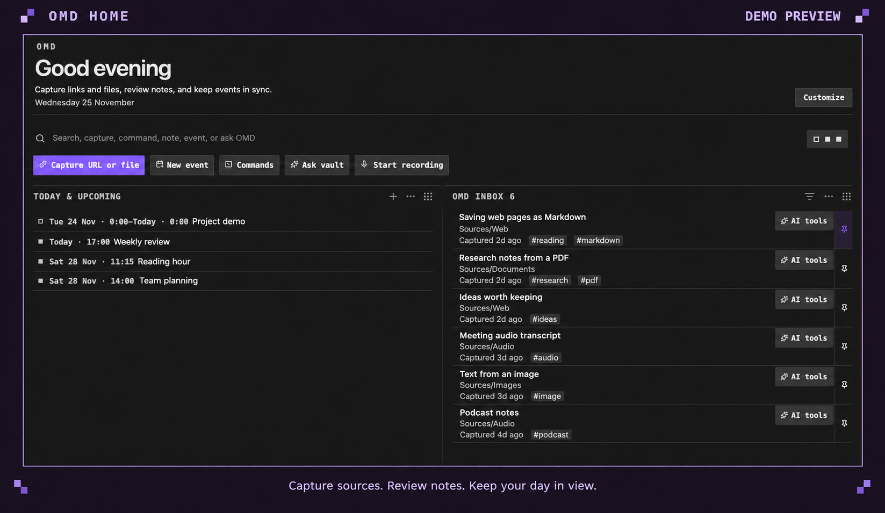
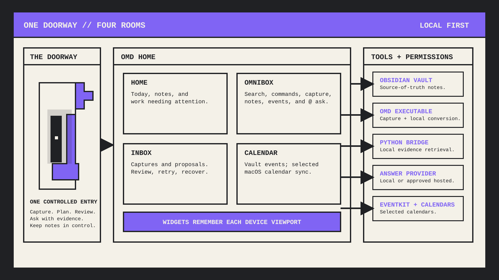
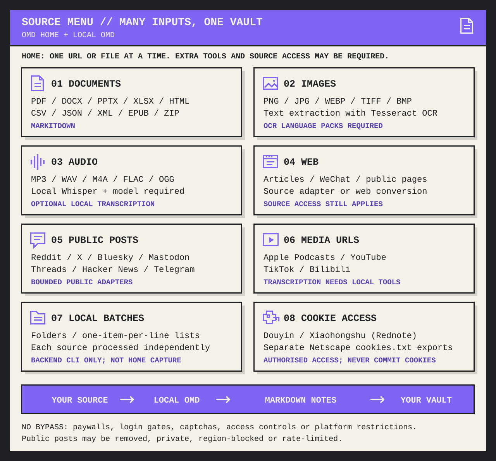
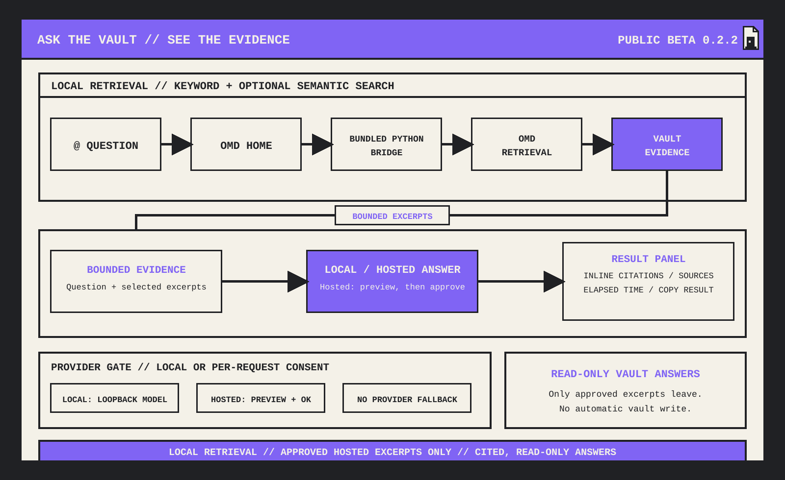

<div align="center">


<sub>OMD HOME // PUBLIC BETA 0.2.3 // CANDIDATE</sub>

# OMD Home

</div>

## About

OMD Home is an Obsidian desktop plugin for turning files and web pages into
Markdown notes, seeing what's on your calendar, and asking questions with
answers grounded in your own notes. Save a source, review suggested links and
tags, and keep the result in your own vault.

Capture needs the separately installed OMD backend. AI and Apple Calendar
integration are optional.

**[Get started →](#install)**

[English installation guide](docs/getting-started-mac.en.md) · [简体中文安装指南](docs/getting-started-mac.md)

[Star this repository on GitHub](https://github.com/omd-local/obsidian-omd-home) · [Follow Jacquelin on LinkedIn](https://www.linkedin.com/in/jacquelin-r-915655123/)

<a href="docs/assets/omd-home-preview.png"></a>

<sub>Edited Home preview with illustrative demo content. Personal titles have been replaced; the view is cropped to the top dashboard. Click the image to view it at full size.</sub>

## From a web page to a Markdown note

Paste an article URL into **Capture URL or file**. OMD saves a Markdown note
in your vault and lists it in **Inbox**. With local AI configured, review its
suggested links and tags before choosing **Apply**.


## Install

> **First-install candidate testing:** download Home 0.2.3 from its PR workflow
> artifact and follow the Mac guide in a test vault. New engine 0.3.0b6 binary
> uploads are blocked pending the Cobble copyright notice and Intel dependency
> vulnerability resolution. Test plugin-only features or an existing compatible
> b5 engine first; do not bypass the gates with an older engine build.
> Release assets are not published; versioned download/BRAT instructions apply
> after publication. The current public
> pair remains [Home 0.2.2](https://github.com/omd-local/obsidian-omd-home/releases/tag/0.2.2)
> and [OMD 0.3.0b5](https://github.com/omd-local/markdown-everything/releases/tag/v0.3.0b5).
> See [candidate scope and acceptance](docs/first-install-beta.md).

For a complete Mac walkthrough, follow the [English guide](docs/getting-started-mac.en.md)
or [简体中文指南](docs/getting-started-mac.md). The steps below pair **OMD Home 0.2.3**
with **OMD Engine 0.3.0b6**. Install the plugin and backend separately; basic
conversion does not need AI.

<a id="from-a-github-release"></a>

### 1. Install the Obsidian plugin

You need **Obsidian desktop 1.11.4 or newer**. OMD Home is **desktop-only**;
it does not run on Obsidian Mobile.

For this candidate, sign in to GitHub and open [Home PR #8](https://github.com/omd-local/obsidian-omd-home/pull/8).
From **Checks**, open the latest successful **CI** run corresponding to the PR's
current commit. On its run summary, download **Artifacts → omd-home-pr-candidate**.
Unpack it and install the three files inside `omd-home` using the same
[English](docs/getting-started-mac.en.md#manual-install) or
[简体中文](docs/getting-started-mac.md#manual-install) guide. The download includes
checksums, build information and test instructions. Artifacts are retained for
14 days; the guides explain expired or missing builds.

<details>
<summary><strong>After the 0.2.3 Release is published: BRAT and manual Release downloads</strong></summary>

Until it is listed in Community Plugins,
the easiest installation route is **BRAT**, a separate community plugin that
downloads and places the release files for you:

1. Open the vault where you want OMD Home. In **Settings > Community plugins > Browse**,
   search for **BRAT** by **TfTHacker**, then **Install** and **Enable** it.
2. In **Settings > BRAT**, select **Add beta plugin** and paste
   `https://github.com/omd-local/obsidian-omd-home`. Click outside the field and wait for the version list.
3. Choose **0.2.3**, leave GitHub token blank for this public repository,
   check **Enable after installing the plugin**, and select **Add plugin**.
4. Close Settings, press **Command–P**, and run **OMD Home: Open home**.

Choosing **0.2.3** pins that plugin version. BRAT does not install the backend,
models, or Calendar helper. Follow the full [English](docs/getting-started-mac.en.md#install-plugin)
or [简体中文](docs/getting-started-mac.md#install-plugin) guide for each click and the manual alternative.

<details>
<summary><strong>Install manually without BRAT</strong></summary>

1. Download the three assets from [release 0.2.3](https://github.com/omd-local/obsidian-omd-home/releases/tag/0.2.3):
   [main.js](https://github.com/omd-local/obsidian-omd-home/releases/download/0.2.3/main.js),
   [manifest.json](https://github.com/omd-local/obsidian-omd-home/releases/download/0.2.3/manifest.json), and
   [styles.css](https://github.com/omd-local/obsidian-omd-home/releases/download/0.2.3/styles.css).
2. In the target vault, open **Settings > Community plugins**, turn on community plugins if needed,
   and select the **folder icon** beside Installed plugins. This opens the current vault's plugin folder.
3. Create an ordinary folder named `omd-home` there; on Mac use **Command–Shift–N**.
   Copy the three files directly inside it. Obsidian creates `.obsidian`; you do not need to create a hidden folder yourself.
4. Back in Community plugins, select the **refresh icon**, enable **OMD Home**,
   and run **OMD Home: Open home**. If absent, quit and reopen Obsidian.

Use files from the same release. GitHub's **Source code (zip)** is not an
installable plugin. The plugin files do not include OMD, Python, models, or
the optional Calendar helper. If the folder icon cannot open a missing directory,
the [manual Mac steps](docs/getting-started-mac.en.md#manual-install) explain how to enter the existing `.obsidian`
directory and create only the ordinary `plugins` and `omd-home` folders.

</details>

</details>

### 2. Install the local OMD backend for capture

OMD performs conversion on your computer. OMD Home does not install, update,
or bundle OMD, Python, Ollama, or the EventKit helper.

Once the license and dependency gates pass, on **macOS 14+** independently obtain the **OMD Engine 0.3.0b6** package matching
your Mac: **arm64** for Apple Silicon or **x86_64** for Intel. For this candidate,
open [Engine PR #16](https://github.com/omd-local/markdown-everything/pull/16), then
the successful **Build independent macOS engine** run under **Checks**. Download
**omd-engine-unsigned-arm64** or **omd-engine-unsigned-x86_64** from its summary's
**Artifacts**. Unpack the download, find the matching `OMD-Engine-…zip` inside
its directories, then unpack that app ZIP and move **OMD Engine.app** to **Applications** or
`~/Applications`. Candidate packages are unsigned and not notarized; they are
for controlled testing and have not passed fresh-Mac or Intel acceptance.
After release, matching assets can instead be obtained from the
[official engine releases](https://github.com/omd-local/markdown-everything/releases).
The source-code archive and Python wheel are not the independent app package.

The app contains Python and basic document converters. The basic route needs
no Homebrew, Xcode, Command Line Tools or Xcode license acceptance. OCR,
ffmpeg/yt-dlp, transcription, Ollama/models and Calendar remain optional.
See the [English](docs/getting-started-mac.en.md#install-backend) or
[简体中文](docs/getting-started-mac.md#install-backend) steps for installation,
existing Homebrew commands and conflict recovery.

In **Settings > OMD Home**, scroll to **Capture and processing** and select
**Detect OMD** or **Check again**. These backend checks are separate from AI's
**Check setup**. Home finds system and user Applications without a shell PATH
change. A ZIP install does not create the bare `omd` command; use the executable
inside the app when testing in Terminal. Existing custom paths stay authoritative;
see [Connect OMD](#connect-omd) to clear an old override. Windows and Linux retain
the [backend source-install route](https://github.com/omd-local/markdown-everything#quick-start).

### 3. Save your first Markdown note

1. Open **Capture URL or file**.
2. Paste a simple public URL such as `https://example.com/`, or drag one small HTML or PDF file from Finder onto **Drop a local file here** inside the dialog.
3. For this first conversion test, leave **Polish Markdown** and **Review links and tags** off. Enable them after setting up local AI.
4. Select **Capture**, watch **Current task**, then open the saved note from **Inbox** and check its content and source.

Next, add [OCR languages, audio transcription, local AI or Calendar integration](#choose-your-setup)
for the workflows you use. The separate backend browser UI is deferred; OMD
Home provides the Obsidian interface.

**Upgrading:** back up your vault, stop captures and disable the plugin before
replacing the three plugin files. Preserve `data.json`, your notes and any
separately installed helper. Upgrade the engine independently using a matching
app package; existing Homebrew installations retain their separate upgrade path.
See the Mac guides for recovery and helper upgrades.

## Core workflows

### One doorway, four rooms

Home, Omnibox, Calendar and Inbox are the four rooms behind one doorway into
your vault. Use each surface for a different part of your day; your Markdown
files remain the source of truth.



#### Four rooms, one source of truth

| Surface | What it is for |
|---|---|
| **Home** | A centered dashboard for Today, Upcoming, Recent notes, Pinned notes, Vault tags, system health, and the work that needs attention. |
| **Omnibox** | Vault search, Obsidian and community commands, quick notes, URL or file capture, event creation, recording commands, and read-only `@` vault questions. |
| **Calendar** | Month, week, day, and list views for Markdown events plus explicitly selected macOS calendars. |
| **Inbox** | Recent OMD captures, review-first link and tag suggestions, current work, failures, timestamps, details, retry, and cancellation. |

Widgets use a 12-column grid, move occupied cards out of the way, and keep their
layout per device viewport. Standard sizes are always available from each
widget menu, so a desktop layout does not have to fit a different screen.

### Bring sources in. Decide what changes.

Paste one public URL, paste one local file path, drop one file onto Home, or
paste a common Douyin or Xiaohongshu / Rednote share message that contains
exactly one HTTP(S) URL.
OMD Home starts a managed OMD process, reports progress, and leaves conversion
ownership with [Markdown Everything](https://github.com/omd-local/markdown-everything).

Local folder and one-item-per-line batch capture are not connected in OMD Home.
Capture writes the requested Markdown note immediately; only optional link and
tag changes wait for review.

#### Source menu



<details>
<summary><strong>Text version // formats, sources, and requirements</strong></summary>

| Source | Formats or examples | Requirements and limits |
|---|---|---|
| **Documents** | PDF, DOCX, PPTX, XLSX, HTML, CSV, JSON, XML, EPUB, ZIP | MarkItDown and the relevant converters. |
| **Images** | PNG, JPG, WEBP, TIFF, BMP | Tesseract OCR and the selected language packs. |
| **Audio** | MP3, WAV, M4A, FLAC, OGG | Local Whisper, its model, and ffmpeg must be installed; see the Mac guide for the Apple Silicon setup. |
| **Web** | Articles, WeChat, public webpages | A source adapter or web conversion; source access rules apply. |
| **Public posts** | Reddit, X, Bluesky, Mastodon, Threads, Hacker News, Telegram | Bounded public adapters; browser login does not guarantee converter access. |
| **Media URLs** | Apple Podcasts, YouTube, TikTok, Bilibili | Metadata and local transcription; install the selected route's tools and model, including yt-dlp for video URLs. Missing tools or source access can stop Capture. |
| **Local batches** | Folders and saved one-item-per-line lists | Backend CLI only; each item is routed independently. Not connected to Home Capture. |
| **Douyin / Xiaohongshu (Rednote)** | A URL or supported single-link share message | Normally require separate Netscape-format `cookies.txt` exports from `douyin.com` and `xiaohongshu.com`, respectively. Use only authorised accounts and content; do not reuse cookie files across platforms or commit them. |

</details>

OMD does not bypass paywalls, login gates, captchas, access controls, or platform
restrictions. Public posts may be deleted, private, quarantined, region-blocked,
or rate-limited. See the **Douyin and Xiaohongshu / Rednote access** setup below
for local cookie paths and readiness checks.

#### Improve a note without losing the source

- **Review links and tags** is proposal-only. Nothing is written until you explicitly press **Apply**.
  Suggested note topics remain ideas only, new tags start unchecked, and adding the proposal summary is optional.
  Applying suggestions keeps the note in Inbox; **Done reviewing** is the only action that marks it Reviewed.
- The **Polish Markdown** and **Review links and tags** capture toggles appear
  only in the Capture dialog. New captures remember the last submitted choices. Cancelling the
  dialog does not change them. Polish Markdown is off by default.

Open a note's **AI tools > Improve formatting**, or run **OMD Home: Improve
note formatting**, to preview a local formatting pass and choose whether to
apply it. Rich captures limit the pass to their Body or Transcript; source
metadata, images, and OCR remain protected. Rejected output leaves the note
unchanged. This requires a backend advertising the local writing interfaces.

When OMD flags an incomplete or problematic transcript, **Review and repair
transcript** offers a separate review flow. Inspect the proposed repair before
applying it; automatic tests do not guarantee every speech segment is correct.

### Ask the vault. See the evidence.

Type `@` in the omnibox to ask a question. Vault Q&A is read-only and renders
its answer in an owned result panel with evidence chips, retrieval mode,
elapsed time, and **Copy result**.

Open the cited notes to check the evidence before using an answer.



Keyword + semantic search combines keyword matches with a locally installed embedding
model. If semantic search fails, OMD Home labels the keyword-only fallback instead of
claiming a combined result. Optional semantic reranking is off by default.

Vault answers describe the evidence actually retrieved, not the whole Vault. A one-source
answer begins with **Based on 1 retrieved note.** Direct evidence appears under **From the
note** (or **From your notes**), while a non-empty interpretation appears under **What this
may mean**. Each substantive claim must carry an inline source citation. Vault links are
restored locally after a cloud answer returns.

For model selection and optional hosted answers, see [local AI and cloud answers](#local-ai-and-cloud-answers).

### Calendar sync with no silent winner

Create a vault-only Markdown event or link it to a writable calendar selected
in settings. OMD Home never enables every calendar by default.


- **Vault**, **Calendar**, and **Linked** are live source filters. At least one
  source remains visible.
- Google Calendar and Outlook Calendar can participate when they have already been added to macOS Calendar.
  Their calendars must also be explicitly selected in OMD Home.
- Start and End use local date and time controls. An all-day End is the
  exclusive calendar date.
- When both linked copies change before sync, OMD Home asks which side to keep.

## Choose your setup

Start with the vault and basic capture, then add tools for the workflows you
want. The plugin checks each backend capability before enabling its integration.

| Capability | Minimum setup | Boundary |
|---|---|---|
| Home, search, commands, quick notes, Markdown events | Obsidian desktop | Current vault only |
| URL, social share-message, and file capture | A compatible local OMD install, discovered automatically when possible; social captures require the exact capture-auth capability contract and, when needed, a provider-specific Netscape `cookies.txt` | One submitted URL, supported one-URL Douyin/Xiaohongshu share message, or file; URLs contact their source |
| Image OCR | Tesseract and the selected language packs | Image text; no promise of scanned-PDF OCR |
| Audio transcription | A local Whisper installation, its model, and ffmpeg | The Mac guide uses Apple Silicon MLX; tools and models are separate from the plugin |
| Link and tag proposals | A compatible OMD executable and local Ollama | Review-first; no write before Apply |
| Local Vault Q&A | OMD with retrieval support, a Python interpreter, and local Ollama | Bounded evidence over loopback; read-only |
| Hosted answer providers | OMD with `ai_service`, provider-model discovery, credential support, and per-question consent grants; DeepSeek unavailable in b5 | Retrieval stays local; after approval the provider receives only the question, bounded excerpts, and opaque source IDs. OMD Home does not add source filenames or paths; text already written inside an approved excerpt is sent exactly as previewed. |
| Keyword + semantic search | A local embedding model selected in settings | Derived vectors stay local; query vectors are not persisted |
| Apple Calendar sync | macOS 14+, EventKit helper, Calendar permission | Explicitly selected calendars only |
| Google or Outlook calendar sync | Account already added to macOS Calendar | Uses the same selected EventKit calendars |

This table describes the plugin's integrations. Availability depends on the
installed backend's advertised capabilities and optional tools. Public b5
supplies the matching Mac interfaces; DeepSeek remains blocked by its verified
provider policy. Start with basic capture, then add the tools you need.

### OCR and audio transcription

Capture keeps OCR and speech recognition separate. On first use, image text
starts with **English** and speech starts with **Auto-detect speech**. Set
vault-wide choices under **Recognition defaults** in Settings, or follow the
language-settings link in the first-run **Welcome to OMD Home** view. OCR can
use `chi_sim+eng` or `chi_tra+eng`; speech can use explicit `en` or `zh`.
Existing saved choices, including **No language preference**, are preserved.
Changing a language in Capture affects only that capture; Retry preserves the
choice without changing your vault defaults.

Capture language scope is deliberately narrow. OCR applies to images,
screenshots, and enabled article-image OCR, not ordinary webpage text or
ordinary/scanned PDF pages. OMD Home does not promise automatic OCR-language
detection. **No language preference** sends no explicit language flag, so the
lower-priority converter setting remains in control. **Auto-detect** explicitly
requests speech-language detection. Polish Markdown is a post-conversion
cleanup step; it is neither OCR nor translation. If an OCR
preset fails, install the named Tesseract language pack and check
`tesseract --list-langs` before retrying.

The [audio transcription steps](docs/getting-started-mac.en.md#7-optional-local-transcription-on-apple-silicon)
cover Whisper and its default model. A first model download needs network
access and disk space; complete a short real capture before a demo.

### Local AI and cloud answers

OMD Home supports explicit answer-provider setup for local Ollama on this computer,
Ollama Cloud through the local Ollama app, OpenAI API, and Anthropic API.
DeepSeek API is visible as a setup choice but remains unavailable under the
verified policy in OMD 0.3.0b5; requests fail closed.

Settings provide:

- **Check setup** for the selected provider, model, and safety boundary.
- **Test semantic search** for local retrieval.
- `OMD Home: Refresh local AI models` from the command palette when you want to
  rescan local Ollama models without changing the saved selection.

<details>
<summary><strong>ASK VAULT SETUP // local by default, cloud by per-request approval</strong></summary>

1. [Install the Ollama Mac app](https://ollama.com/download), move it to
   Applications, open it, complete CLI setup, and leave it running. The
   [complete Mac guide](docs/getting-started-mac.en.md#8-optional-local-ai-formatting-and-semantic-search)
   includes the model, writing, and retrieval checks.
2. If you want local Vault Q&A, enrichment, or Polish Markdown, install a
   completion model yourself. For example:

   ```bash
   ollama pull qwen3:4b-instruct
   ```

   When the checked catalog is missing your selected answer or writing model,
   Settings shows its exact safe command and **Copy install command**. Run it in
   Terminal, wait for the download to finish, then choose **Check setup** again.
   That check refreshes the catalog and verifies the same model. Unreachable
   Ollama and incompatible models receive different recovery guidance; the
   plugin does not download or switch a text model for you.

3. To add semantic search to keyword search, install a local embedding model such as `bge-m3`:

   ```bash
   ollama pull bge-m3
   ```

   Choose it under **Advanced AI controls > Vault retrieval**, then press
   **Test semantic search**. If the selected model is missing, use
   **Copy install command**, run the command yourself in Terminal, wait for it to
   finish, then run **Check setup** and **Test semantic search** again. Copying,
   checking setup, and asking a question do not download a model.
   **Switch to keyword search** turns off semantic search for
   future vault questions and saves that choice; keyword search needs no embedding model.
4. In **Settings > OMD Home > AI answers**, choose an answer provider.
   - For **Ollama on this computer**, choose a local model and press **Check setup**.
     A downloaded model marked **unverified** is still selectable when Ollama
     omits capability metadata; Check setup inspects it before use.
   - For **Ollama Cloud**, follow [Ollama Cloud](#ollama-cloud) for the
     first-run sign-in, model selection, and per-request preview flow.
   - For **OpenAI API** or **Anthropic API**, configure a developer API key,
     then choose a model from the catalog. **DeepSeek API** is unavailable
     under the current backend policy, even if shown as a choice.
     On macOS, paste the actual API key into the password field and press
     **Save & check** to store it in macOS Keychain and immediately check the
     provider connection. On Windows and
     Linux, set `OPENAI_API_KEY` or `ANTHROPIC_API_KEY` before starting
     Obsidian. Keys never enter notes or plugin settings.
     OpenAI API billing stays separate from ChatGPT subscriptions, and Anthropic API billing stays separate from Claude subscriptions.
5. If local models changed on disk, run **OMD Home: Refresh local AI models**
   from the command palette, then return to **Check setup**.
6. Leave the Python bridge override blank to use the bridge bundled in
   `main.js`. For OMD Engine.app, Home verifies and uses Python inside the
   same app, including paths with spaces and a CLI symlink. Other macOS/Linux
   installs retain launcher-shebang discovery. On Windows, it verifies `python.exe`
   beside the launcher or at the root of its `Scripts` environment. For a
   non-standard environment, set an explicit Python executable.

#### Ollama Cloud

Ollama Cloud requires an Ollama account and whatever cloud billing or usage rules Ollama applies to cloud models. OMD Home only reads the local Ollama app's cloud state; it does not manage Ollama billing or switch providers for you.

1. Sign in to Ollama:

   ```bash
   ollama signin
   ```

2. Confirm a cloud-backed model is available:

   ```bash
   ollama pull gpt-oss:120b-cloud
   ollama run gpt-oss:120b-cloud
   ```

3. In **Settings > OMD Home > AI answers**, choose **Ollama Cloud**.
4. Press **Check setup** to load the detected cloud model metadata.
5. Select the cloud-backed model you want to use.
6. Turn on the selected provider's **Allow … answers** toggle only when you want `@`
   questions to send the question plus bounded evidence excerpts. The label always matches the
   current provider, for example **Allow Ollama Cloud answers**.
7. Review the preview modal every time. Cancel sends nothing; Send keeps the selected provider and model fixed.

Official provider references:

- [Ollama API introduction](https://docs.ollama.com/api/introduction)
- [OpenAI API model docs](https://developers.openai.com/api/docs/models)
- [Anthropic API overview](https://platform.claude.com/docs/en/api/overview)
- [DeepSeek API docs](https://api-docs.deepseek.com/api/deepseek-api)

OMD Home does not download models, auto-select models, or auto-switch providers.
Model installation commands are copied for you to run independently in Terminal.
Local answer and writing dropdowns show all downloaded models that
stay on this computer. Compatible completion models and models awaiting
capability verification are selectable; known incompatible models remain
visible but disabled with a reason. Remote-backed models stay out of the local
catalog. An incompatible, remote-backed, or stale saved selection remains
visible with recovery guidance and is never silently replaced.

If you want Ollama itself to run in local-only mode, you can still set
`disable_ollama_cloud` in `~/.ollama/server.json` or export `OLLAMA_NO_CLOUD=1`
inside Ollama. OMD Home does not require that setting for local model use, and
it never writes the file for you.

</details>

### Apple Calendar setup

<details>
<summary><strong>CALENDAR SETUP // EventKit and selected accounts</strong></summary>

Apple Calendar integration needs macOS 14+ and a separately built EventKit helper.
Follow the [complete Calendar steps](docs/getting-started-mac.en.md#11-optional-apple-calendar)
to clone the pinned 0.2.3 source, build with Swift 6+ and Xcode Command Line
Tools, and copy `omd-eventkit` through Finder into the actual plugin folder.
The helper build uses `sh scripts/build-eventkit.sh`; it needs neither Node.js
nor npm dependencies. Markdown-only events need no helper.

In **Settings > OMD Home > Calendar**, select **Refresh calendars**, grant the
requested macOS permission, enable only approved calendars, and choose a writable
**Default calendar**. Create a test event in OMD Home with **Destination** set to
**Vault + [your calendar]** and check both copies. A system Calendar event alone
does not automatically become a vault note.

For a helper stored elsewhere, paste its actual executable path into
**Advanced Calendar helper > Helper override**. Do not select a source directory.

Windows and Linux keep Markdown calendar features but do not expose Apple
Calendar controls.

</details>

### Douyin and Xiaohongshu / Rednote access

Use separate Netscape `cookies.txt` exports for the two platforms, from
accounts and content you are authorised to use. Home stores each local file
path; it does not import your browser session automatically. Never commit the
cookie files.

<details>
<summary><strong>Cookie setup, readiness checks and retries</strong></summary>

These examples can be pasted directly to exercise share-message parsing. The
Xiaohongshu short link is a format example; replace it with a public post you
can open when testing a real capture.

```text
9.74 hoD:/ w@S.YZ :9pm 08/06 9.17 深度理解沃什在议息会议后的发言 https://v.douyin.com/t6DOaFdc39Q/ 复制此链接，打开Dou音搜索，直接观看视频！
32 复制本条信息，打开【小红书】App查看精彩内容！ http://xhslink.com/a/abcDEF/
```

Some public posts still require the session from your own browser. Export a
Netscape-format `cookies.txt`, then set its absolute path under **Settings > OMD
Home > Capture and processing > Social capture access** or **Site access** in the
Capture dialog. Douyin and Xiaohongshu / Rednote have separate fields. Both may
be configured at once; a Douyin request never falls back to the Xiaohongshu
file, and the reverse is also true.

OMD Home saves only these local paths. It does not read or copy cookie contents
into plugin settings, notices, logs, the vault, or generated notes. Cookie
contents are used by local OMD only for matching approved platform HTTPS
requests; they are never sent to AI providers. Before Capture closes,
OMD Home runs a bounded source-specific readiness check. Missing, unreadable,
invalid-format, wrong-domain, and expired cookie files produce short corrective
messages without showing the full local path.

For a Xiaohongshu short link, the first readiness check is provisional because
the final post host is known only after redirect. OMD Home shows a brief note,
and local OMD checks the resolved destination again before using the matching
cookies. A rejected redirect never receives cookies.

This path is enabled only when OMD capabilities explicitly advertise
`capture_auth_options.share_text.supported: true`,
`capture_auth_options.share_text.requires_single_http_url: true`, and
`capture_auth_options.platform_cookie_flags` with the exact `douyin` value
`--douyin-cookies` and `xhs` value `--xhs-cookies`. If that contract is missing
or differs, OMD Home asks you to update OMD; use **Check again** under **Capture and processing** rather than
inferring support from a version number. A runtime failure appears in **Needs
attention** with **Retry capture**. Retry restores the original pasted share
message and its Capture choices, but reads the current cookie-path settings so
a repaired or replaced file is used.

</details>

## Platform support

| Platform | Available now |
|---|---|
| **macOS desktop** | Home, Inbox, omnibox, and Markdown events; capture and AI require compatible tools. Selected-calendar sync requires macOS 14+ and the helper. The independent document engine requires macOS 14+; see the guide for candidate test limits. |
| **Windows and Linux desktop** | Home, capture, Inbox, omnibox, Markdown events, and local AI; no Apple Calendar integration |
| **Mobile** | The plugin is desktop-only. |

## Privacy and failure boundaries

- No OMD Home telemetry, ads, account creation, or payment flow.
- No helper install, executable update, model download, or automatic model switch.
  Model setup displays a validated command; copying it does not execute it.
- OMD setup actions copy official text or open an external guide. They never
  execute an installer or mutate a Python environment.
- OMD Home reads and writes the current vault. A local file capture reads only
  the external path you explicitly submit; it does not scan neighboring files.
- Some local processing creates temporary Markdown or audio copies in the system
  temporary directory. Normal cleanup removes them; interrupted processes can
  leave temporary files. They are not uploaded by this temporary-file step.
- Optional social capture stores separate local cookie paths. See the
  [cookie access boundaries](#douyin-and-xiaohongshu--rednote-access) before
  enabling these routes.
- Optional EventKit integration uses local macOS permissions and only the
  calendars selected in OMD Home.
- URL conversion is local-first, not offline: OMD contacts the URL you submit.
- Review-first note enrichment sends only bounded note content, ranked
  candidate metadata, and bounded vault tags to the detected local OMD
  installation.
- Polish Markdown sends only the captured note content needed for that local
  cleanup pass.
- Retrieval, capture, enrichment, and embedding work remain local. Only an
  explicitly approved cloud answer request sends selected evidence to its
  provider. Review generated answers, links, and tags before relying on them.

<details>
<summary><strong>Local AI endpoints and per-request cloud approval</strong></summary>

Local Ollama remains the default answer path. Hosted providers are explicit
opt-ins: every cloud answer request shows a preview with the selected provider,
model, and bounded evidence excerpts before anything leaves the device. OMD Home sends only the question plus the selected local evidence snippets; it never sends the whole vault. The UI uses that preview only for the immediately approved request; there is no silent fallback across providers or auto-switch to another provider.

Local endpoint rules:

- The live local Ollama path defaults to `http://localhost:11434`. A manual
  endpoint may use `localhost`, `127.0.0.1`, or `[::1]` with an explicit custom
  port. Select **Save endpoint** before checking the new daemon; the previous
  verified setup is invalidated only when that explicit save succeeds. LAN and
  remote hosts, credentials, paths, queries, fragments, proxies, and redirects
  are rejected.
- Local answer mode, note enrichment, Polish Markdown, and local embedding-based
  retrieval stay on loopback Ollama. Cloud availability does not block local
  model selection.

</details>

## Troubleshooting

**Needs attention** shows setup and capture failures with a recovery action.
Start with the matching check below, or use the [Mac troubleshooting guide](docs/getting-started-mac.en.md#troubleshooting).

| Problem | What to check |
|---|---|
| OMD is missing or still reports b4 | Update the backend, select **Check again** under **Capture and processing**, and check the executable selected under Advanced OMD paths. |
| OCR language is unavailable | Run `tesseract --list-langs` and install the required language pack. |
| Audio transcription fails | Check the Whisper program, downloaded model and ffmpeg; follow the Apple Silicon transcription steps in the Mac guide. |
| Local AI cannot connect or use a model | Start Ollama, confirm a compatible downloaded model, then run **Check setup**. |
| A social post cannot be captured | Check source access, the matching platform cookie file and the readiness message. A browser login does not guarantee converter access. |
| Apple Calendar is missing | Check the separate helper, macOS permission and explicitly selected calendars. |

[Report a bug or request a feature](https://github.com/omd-local/obsidian-omd-home/issues)
with your plugin/backend versions and relevant check output. Remove private
paths and credentials; never include cookies or API keys. Use the
[security policy](SECURITY.md) for private vulnerability reports.

### Connect OMD

On startup, OMD Home checks the app executable path and safe common locations
used by Homebrew, MacPorts, user installs, and local Python environments. It
probes candidates for the compatible OMD capability contract and can continue
past a missing or outdated candidate to find a current one.

If no compatible install is found on macOS, **Settings > OMD Home > Capture and processing**
and Home's **Needs attention** offer **Download OMD engine**, **Install guide**
and **Check again**. Home discovers `/Applications/OMD Engine.app` and
`~/Applications/OMD Engine.app`. Download opens the official release page; the
user downloads and installs the engine independently. Other desktop systems
retain copyable source-install steps. These actions do not execute an installer,
run a package manager, request administrator access or change a Python environment.

Most users should leave **Advanced OMD paths** closed. Open it only to select a
specific OMD or Python environment when automatic discovery cannot reach the
right one. Clearing the OMD override restores automatic discovery.

If Terminal and OMD Home appear to use different installs, run `omd --version`
and `omd capabilities --json` against the executable path shown by OMD Home.
Capability checks determine readiness; a version number alone does not verify
every optional tool or model.

To launch the bundled bridge, OMD Home may read the detected OMD launcher's
file to inspect its shebang, or resolve and validate the interpreter inside
the selected OMD Engine.app. Portable bridge execution uses isolated Python
with bytecode writes disabled. Home starts only the local executable you
configured or that passed automatic capability checks.

### Commands and status

The command palette exposes the main workflows without requiring the Home view
to be open:

<details>
<summary><strong>Commands, task status and cancellation</strong></summary>

- **Open home** and **Focus omnibox**
- **Open calendar**, **Create event**, and **Sync linked calendar events**
- **Capture URL or file** and **Cancel active OMD action**
- **Check OMD setup** and **Open OMD install guide**
- **Open language settings** and **Improve note formatting**
- **Suggest links and tags**
- **Refresh local AI models**, **Check local AI connection**, and
  **Test local AI embeddings**
- **Start or stop recording**, **Start recording**, and **Stop recording**
- **Refresh macOS calendars**

The omnibox **Commands** action also searches commands from Obsidian core and
enabled community plugins. Recording exposes a wrapper command that delegates to Obsidian's own recorder toggle or Start/Stop commands; if the underlying recorder is unavailable, OMD Home should tell you how to enable it rather than guess a second recorder state.

**Current task** shows only active work. **Cancel** appears only while that work
can still be stopped; after OMD has saved a capture, the short Inbox/indexing
finalization remains visible without a misleading Cancel button. **Needs
attention** owns unresolved failures with a timestamp, safe source label,
details, and the right recovery action for that failure, such as capture retry,
Local AI checks, or Calendar follow-up. A failed capture keeps its own Retry even
if a later setup check reports another issue. Missing or incompatible OMD,
Ollama, model, bridge, and EventKit states surface there instead of failing
silently.

Share-message extraction is deliberately limited to Douyin and Xiaohongshu /
Rednote. Paste an ordinary webpage URL by itself. Text with no HTTP(S) URL,
more than one URL, or a non-HTTP(S) scheme is rejected instead of guessing.

- Public URL capture processes one submitted source, including required
  redirects and media resources. A local file capture reads only the single
  file path you submit.
- Drag and drop, `~/` paths, and shell-escaped spaces are normalized without
  evaluating a shell command.
- Capture continues when the Home tab is backgrounded or closed. Cancel,
  plugin unload, or quitting Obsidian stops plugin-owned child work. On macOS
  and Linux, cancellation also stops the OMD process group, including nested
  `yt-dlp`, `ffmpeg`, and Whisper work, with a bounded forced stop if needed.

</details>

## Development and release

[](https://github.com/omd-local/obsidian-omd-home/actions/workflows/ci.yml)
[](https://github.com/omd-local/obsidian-omd-home/releases/latest)

### From source

<details>
<summary><strong>Build the pinned release and install into a test vault</strong></summary>

```bash
git clone --branch 0.2.3 --single-branch https://github.com/omd-local/obsidian-omd-home.git
cd obsidian-omd-home
npm ci
npm run build
```

This selects the public release source explicitly. Public `main` includes
this release's source and will continue to change; use the tag to reproduce it.

If you also want to test Apple Calendar integration from source on macOS, build
the helper before installing into the repository test vault:

```bash
npm run build:eventkit
npm run install:test-vault
```

`npm run install:test-vault` always copies `main.js`, `manifest.json`, and
`styles.css` into this repository's disposable `test-vault/`, preserving an
existing plugin `data.json`. It also copies `dist/omd-eventkit` when a built
executable helper is present. Settings and this optional helper are not release assets.

</details>

### Checks and contract fixtures

<details>
<summary><strong>Run checks and review backend contract updates</strong></summary>

Run typecheck, lint, tests and the production build:

```bash
npm run check
```

To check the copied OMD enrichment contract fixtures without writing:

```bash
node scripts/sync-omd-contract-fixtures.mjs /path/to/omd
```

After reviewing upstream contract and validator changes, accept an intentional
fixture update with `--accept`.

</details>

### Release and contributor guides

| Read this | When you need it |
|---|---|
| [Mac guide: English](docs/getting-started-mac.en.md) / [简体中文](docs/getting-started-mac.md) | Downloads, backend, first capture, optional features, upgrades, and recovery |
| [Manual test plan](https://github.com/omd-local/obsidian-omd-home/blob/0.2.3/docs/manual-test-plan.md) | Exact desktop QA, local AI benchmarks, background work, reload, and unload cases |
| [Release checklist](https://github.com/omd-local/obsidian-omd-home/blob/0.2.3/docs/release-checklist.md) | Community Plugins packaging, privacy, compatibility, and release gates |
| [Security policy](SECURITY.md) | Supported versions and private vulnerability reporting |
| [Third-party notices](THIRD_PARTY_NOTICES) | Licences and notices for bundled third-party components |

<details>
<summary><strong>Release packaging and acceptance</strong></summary>

GitHub release assets contain exactly `main.js`, `manifest.json`, and
`styles.css`. External helpers remain optional manual prerequisites and must not
be assumed present after a Community Plugins install.

Pushing a tag matching the manifest version builds a draft GitHub release.
Verify the three downloaded assets and install them in a clean test vault before
publishing the draft. Mark releases with incomplete desktop acceptance as
prereleases and describe the remaining validation gaps in their release notes.

The plugin release tag must exactly match `manifest.json`, without a `v`
prefix. Helpers, models and runtimes are separate from the three plugin assets.

</details>

## Author

OMD Home is maintained by [shion92](https://github.com/shion92) and OMD Local
contributors. [Follow Jacquelin on LinkedIn](https://www.linkedin.com/in/jacquelin-r-915655123/).

## License

[](LICENSE)

OMD Home is source-available under the
[PolyForm Shield License 1.0.0](LICENSE). Company-wide internal use is
permitted. You may not use OMD Home to provide or market a product or service
that competes with OMD Home or the OMD product family without a separate
license from the copyright holders.

The licence text controls if this summary and the licence differ. Third-party
components remain under their own licences; see
[THIRD_PARTY_NOTICES](THIRD_PARTY_NOTICES).

<div align="center">

**CAPTURE ON REQUEST -> REVIEW AI CHANGES -> KEEP THE VAULT YOURS**

[Get started](#install) ·
[Star on GitHub](https://github.com/omd-local/obsidian-omd-home) ·
[Follow Jacquelin on LinkedIn](https://www.linkedin.com/in/jacquelin-r-915655123/)

</div>
